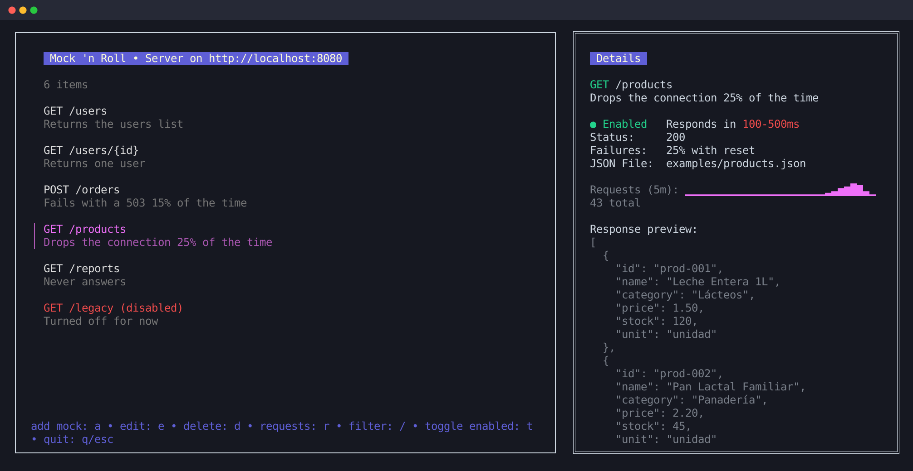
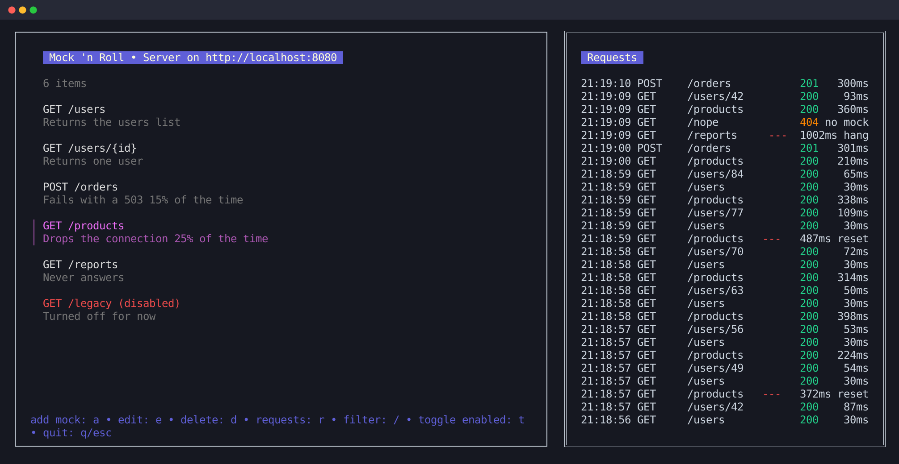

<h1 align="center">mocknroll</h1>

<p align="center">
  <strong>Fake any HTTP API from your terminal, and make it slow, flaky or broken on demand.</strong>
</p>

<p align="center">
  <a href="https://github.com/sebaguadagna/mocknroll/actions/workflows/ci.yml"></a>
  <a href="go.mod"></a>
  <a href="LICENSE"></a>
</p>

<p align="center">
  
</p>

Your app works fine against a healthy backend. But what does it do when a response takes two seconds, when one request in four fails, or when the server never answers? `mocknroll` is a terminal UI for defining mock endpoints and finding out, before you have a real backend to break.

## Features

- 🐢 **Realistic latency:** a fixed delay or a random range per mock, color-coded by severity.
- 💥 **Simulated failures:** fail a percentage of requests with an HTTP status, a dropped connection, or a request that never answers.
- 🧩 **Path parameters:** one mock for `/users/{id}`, with the captured value available in the response.
- 📡 **Live request log:** method, path, status and duration of recent requests, including those no mock matched.
- 🧭 **Guided form:** add or edit a mock step by step, with each field validated as you go.
- 🔍 **Everything at a glance:** filter the list, turn mocks on and off, and see each mock's traffic and response preview.
- 🐳 **Runs anywhere:** build it with Go or run it with Docker. Your mocks are saved to `mocks.json`.

<p align="center">
  
</p>

## Quick start

With Go 1.25+:

```sh
git clone https://github.com/sebaguadagna/mocknroll.git
cd mocknroll
make run
```

Or with Docker, no Go needed:

```sh
git clone https://github.com/sebaguadagna/mocknroll.git
cd mocknroll
docker build -t mocknroll .
docker run -it --rm -p 8080:8080 mocknroll
```

The first run creates two example mocks. From another terminal, try one:

```sh
curl http://localhost:8080/api/v1/users
```

## Usage

| Key         | Action                                                     |
|-------------|------------------------------------------------------------|
| `↑/k` `↓/j` | Move through the mock list                                 |
| `/`         | Filter mocks                                               |
| `a`         | Add a new mock                                             |
| `e`         | Edit the selected mock                                     |
| `d`         | Delete the selected mock (asks for confirmation)           |
| `t`         | Turn the selected mock on or off                           |
| `r`         | Switch the right panel between details and the request log |
| `q` / `Esc` | Quit (asks for confirmation)                               |

In the form, `Enter` advances to the next field or saves on the last one, and `Esc` discards the form.

Mocks are saved to `mocks.json` in the working directory, and response file paths are relative to it. If mocknroll can't save, the list shows an error in place of its help line.

### Choosing a port

The server listens on port `8080`. To use another one, from 1 to 65535, pass `--port`:

```sh
bin/mocknroll --port 9000   # after make build
go run . --port 9000
```

### Simulating an unreliable backend

The delay field takes a fixed value (`200`) or a range (`100-500`). With a range, each request waits a random time within it.

The failure rate is the percentage of requests that fail, decided independently for each one. A rate of `0` turns this off. A failing request still waits the configured delay, then fails according to the mock's failure type:

| Type | What happens | What the client sees | In the request log |
|---|---|---|---|
| `http` (default) | Answers the failure status (400–599, `500` by default) with `{"error": "simulated failure"}` | An HTTP error | The status, marked `fail` |
| `reset` | Aborts the TCP connection without responding | `connection reset` | `---`, marked `reset` |
| `hang` | Accepts the request and never responds | Nothing, until its own timeout | `---`, marked `hang`, once the client disconnects |

A client with no timeout waits on a `hang` until it's stopped, which is the bug this type helps you find.

### Path parameters

A path segment written as `{name}` matches any single segment, so `GET /users/{id}` answers `/users/42` and `/users/abc`, but not `/users` or `/users/42/orders`. A parameter must be a whole segment, so `/files/{id}.json` isn't valid.

When several mocks match a request, the one with the most literal segments answers, whatever their order in the list: `GET /users/me` wins over `GET /users/{id}`. On a tie, the first in the list answers.

In a mock with parameters, each `{name}` in the response file is replaced with the value from the request. With a file holding `{"id": "{id}"}`, `/users/42` answers `{"id": "42"}`. Values are JSON-escaped, and the file itself isn't changed.

### Running with Docker

The `-it` is required because mocknroll is a terminal UI. Without a mount, your mocks are lost with the container. To keep them, mount a directory at `/data` and run as your own user, so you can write to it and own the files:

```sh
docker run -it --rm -p 8080:8080 --user "$(id -u):$(id -g)" -v "$PWD:/data" mocknroll
```

Response file paths are resolved inside the container, so they must be in the mounted directory. Relative paths such as `examples/users.json` work as they do outside Docker.

Arguments go after the image name. The title shows the port inside the container, so publish the same port on the host:

```sh
docker run -it --rm -p 9000:9000 mocknroll --port 9000
```

With Docker Desktop, a published port turns a `reset` into a clean close, so a client on the host sees an empty reply instead of `connection reset`. It's still a connection failure with no response, but a client in the container's network, or running mocknroll outside Docker, sees the real reset.

## Development

```sh
make build   # build to bin/mocknroll
make run     # go run .
make test    # go test -v ./...
make fmt     # go fmt ./...
make vet     # go vet ./...
make deps    # go mod tidy && go mod vendor
```

See [`CLAUDE.md`](CLAUDE.md) for a closer look at the project's architecture.

## Contributing

Issues and pull requests are welcome. This is a small, actively evolving project, so it's a good time to shape where it goes. See the [roadmap](ROADMAP.md) for what's planned.

## License

[MIT](LICENSE) © Sebastián
